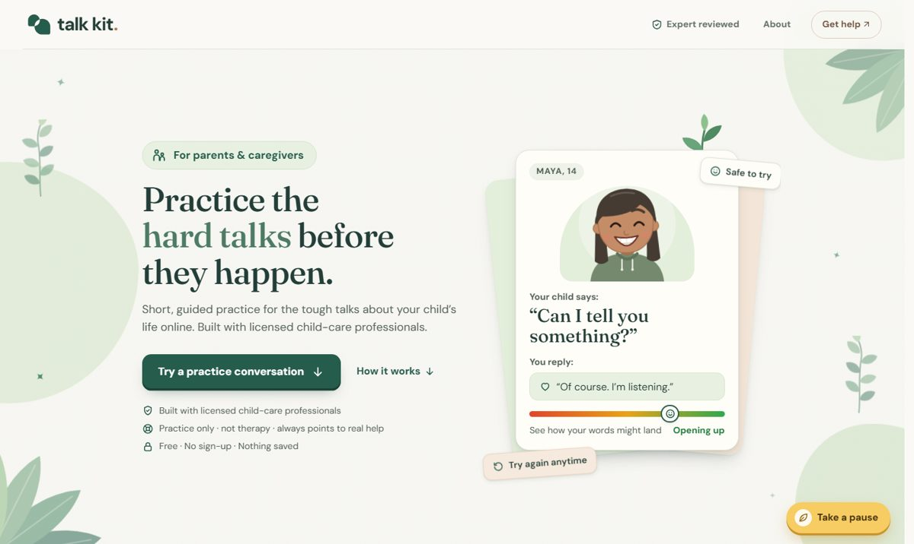
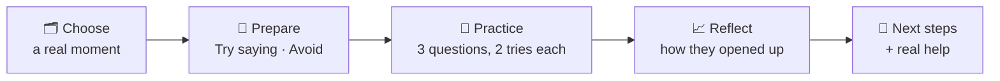
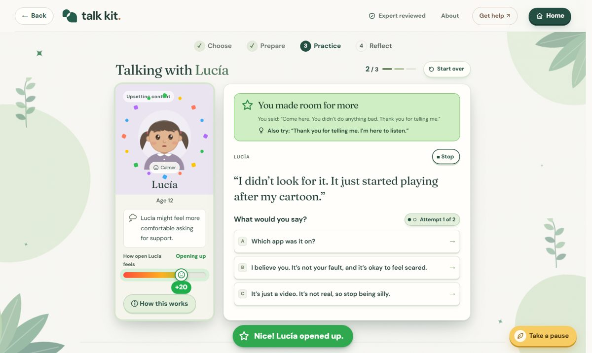
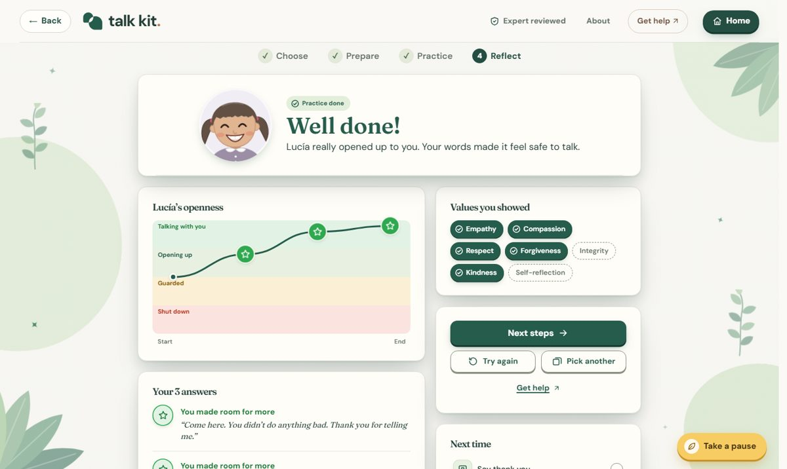
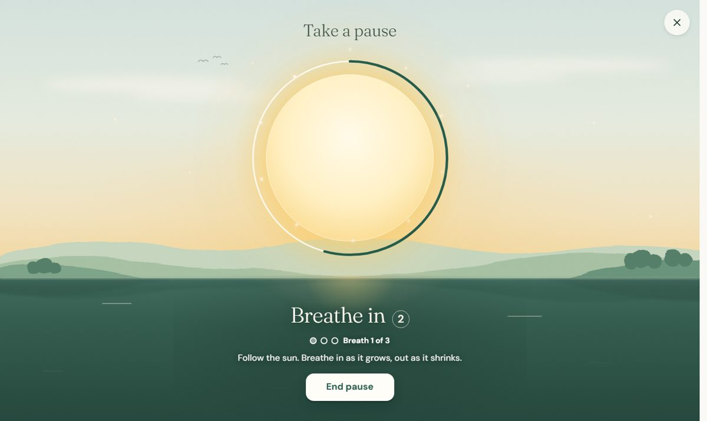

<div align="center">


# talk kit.

### Practice the hard talks before they happen.

A free website where parents and caregivers rehearse the tough conversations about their child's life online, with a child who reacts to every word.

[](https://talk-kit.vercel.app)




</div>

---

## 💬 Why it exists

When a child finally says *"Can I tell you something?"*, a parent gets one chance. A panicked *"Why would you do that?"* can close the door for a long time.

You can read advice anywhere, but you can't **practise** it. Talk Kit is a safe place to rehearse those moments first: strangers asking for photos, group chats that turn cruel, scary videos, comparison, late-night scrolling.

> **Built around a simple idea:** the bond between a parent and a child is like a young plant. It grows with small, steady care. That's why the app is green, papery and full of leaves.

---

## 🌱 How it works



| | |
|---|---|
| **12 stories** in 4 topics | Online contact · Friendship & belonging · Content & feelings · Digital boundaries |
| **3 children** | Maya (14), Jayden (17) and Lucía (12): hand-drawn SVG characters with four moods and recorded voices |
| **Every reply matters** | Each answer instantly changes the child's face, mood and openness meter |

<div align="center">

</div>

---

## 🎯 The openness meter

Every child starts in the middle. Your words move them.

| Your answer | 1st try | 2nd try | What you see |
|---|:---:|:---:|---|
| ⭐ Kind, supportive | **+20** | +10 | Confetti, a full-teeth grin, *"Nice! Maya opened up."* |
| 🌱 Making it right | – | **+10** | The child softens again |
| ❓ Asking a question | **+5** | +3 | *"Hmm, she isn't sure yet."* |
| ⚠️ Promising secrecy | **−5** | −5 | A gentle caution |
| 💔 Blaming | **−20** | −20 | A rain cloud, tears, *"Ouch."* |

- **Two attempts per question:** a hurtful first answer opens one *"make it right"* try, because repairing a moment matters as much as getting it right.
- **Good answers on the 2nd try count half**, so the first instinct still matters.
- **It's practice, not a grade.** The meter only helps parents *see* how words might land.

---

## ✨ Things we're proud of

<table>
<tr>
<td width="50%">

**🧒 Living characters**<br>
Vector kids that blink, breathe, talk in sync with their recorded lines and react: jump for joy, droop under a rain cloud, peek out from behind the *Next steps* card.

**🌅 Take a pause**<br>
A golden button that *grows* into a painted dawn lake. A sun guides you through three breaths (4s in, 6s out) with a filling ring and countdown, then folds back into the button.

**🍃 Loading screen**<br>
The logo draws itself, fills in, and flies into the header while Maya, Jayden and Lucía bounce like a typing indicator.

</td>
<td width="50%">

**📈 Reflection that teaches**<br>
A chart of how the child opened up, answer by answer; better wording for anything hurtful; and the **Humanity 101 values** you showed: empathy, compassion, respect, forgiveness, integrity, kindness, self-reflection.

**🛡️ Built for expert review**<br>
Every story is designed to pass a five-step review by licensed child-care professionals: verify the license, read every line, check the advice, fix what's flagged, and show who signed off.

**♿ For every parent**<br>
Big text, plain words, keyboard support, screen-reader labels, reduced-motion support, and phone to desktop layouts.

</td>
</tr>
</table>

<div align="center">


</div>

---

## 🔒 Privacy and safety

- **No accounts, no tracking, no database.** Nothing a parent taps leaves their device.
- **Practice, not therapy.** Every help page points to real support: the NCMEC CyberTipline, StopBullying.gov, and 911 or local emergency numbers.
- **Not AI.** The stories, replies and feedback are written content, not generated on the fly.
- **Voices are pre-recorded** audio files, played locally.

---

## 🛠️ Under the hood

```text
index.html            page shell, header, loading screen, pause overlay
assets/app.js         every screen and interaction
assets/engine.js      scoring, moods and content checks
assets/pause.js       grow-from-button transition + guided breathing
assets/loading.js     logo intro and fly-into-header exit
assets/*.css          styles (styles.css, talkkit-v2.css, loading.css)
data/scenarios.json   all 12 stories, replies, tips and next steps
assets/audio/         recorded voice lines for each child
```

- **No framework, no build step, no server.** Plain HTML, CSS and JavaScript modules, deployed as static files on Vercel.
- **Content-driven:** new stories, languages or voices are data changes, not code changes.
- **Smooth by design:** animations use only `transform` and `opacity`, so they stay smooth on phones.

### Run it locally

```sh
python -m http.server 8000
# then open http://localhost:8000
```

Serve the folder rather than opening `index.html` directly, because the app loads its stories with `fetch`.

---

## 🚀 What's next

- [ ] Onboard licensed child-care professionals to review every story
- [ ] Pilot with 20 parents, then schools and libraries
- [ ] Spanish version, with local help lines
- [ ] More moments: sextortion, AI chatbots, younger kids and screens

<div align="center">

---

**Team13 · Humanity.exe**

*Small words. Big openings.* 🌱

</div>
